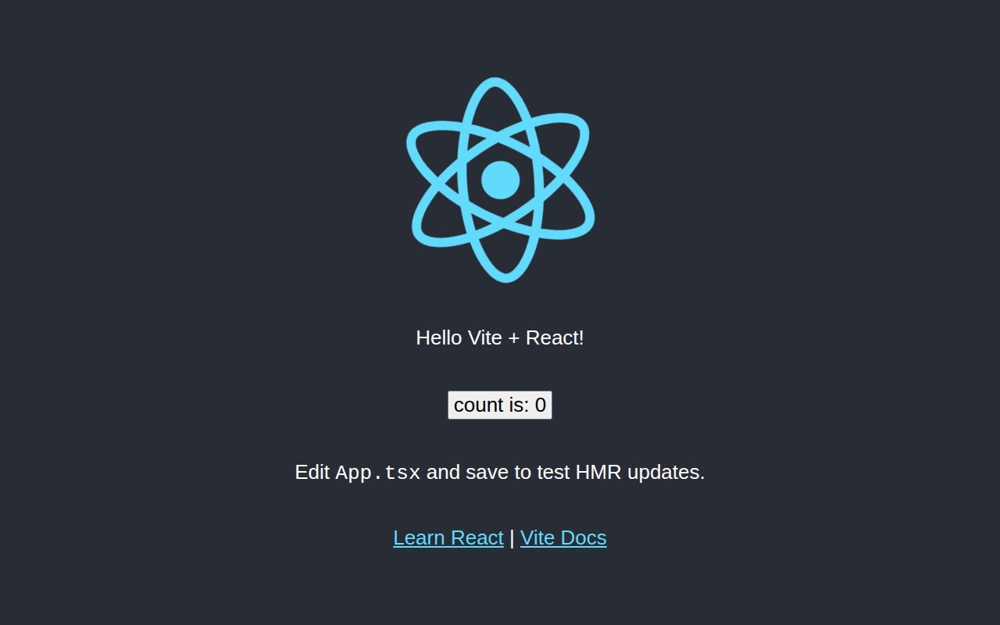

<p align="right"><a href="README.md">中文</a></p>

<p align="center">
  
</p>

<p align="center">
  <a href="https://xiaosang.cc/offer-calculator/">▶ Try Online</a>
  ·
  <a href="https://github.com/holynova/offer_calculator">GitHub Repository</a>
</p>

> **Current status: scaffold.** This repo aims to be a job-offer comparison tool ("Compare and evaluate job offers side by side"), but the code is still the unmodified Vite + React template — `App.tsx` only renders the default "Hello Vite + React!" counter, with no offer-comparison feature yet. This README documents the scaffold as it stands; the comparison features are still to be built.

## Screenshots

<p align="center">
  
</p>

## What's Here

- A Vite + React 18 + TypeScript scaffold (default `vite.config.ts`, `@vitejs/plugin-react`).
- The default template page: React logo, counter button, and the "Edit App.tsx and save to test HMR updates" hint.
- Hot Module Replacement ready — edit `src/App.tsx` and it hot-reloads.

## Not Yet Implemented

- Offer entry (salary, bonus, equity, benefits fields) — none.
- Side-by-side comparison views and total-compensation math — none.
- Data storage (local or remote) — none.
- Tests — none (`package.json` has no test script, and the repo has no test files).

## Run Locally

```bash
npm install
npm run dev      # Vite dev server, HMR
npm run build    # tsc + vite build, output to dist/
npm run preview  # Preview the production build locally
```

## Tech

- React 18 + Vite 2 + TypeScript 4.6; the only runtime dependencies are `react` and `react-dom`.
- The `index.html` title is still the default "Vite App" — it should be changed when the features are built.

```
index.html              Entry (title still the default Vite App)
vite.config.ts          Default Vite config + React plugin
src/main.tsx            React entry
src/App.tsx             Default template page (counter)
src/App.css             Template styles
src/index.css           Global styles
src/logo.svg            React logo
src/favicon.svg         Icon
```
