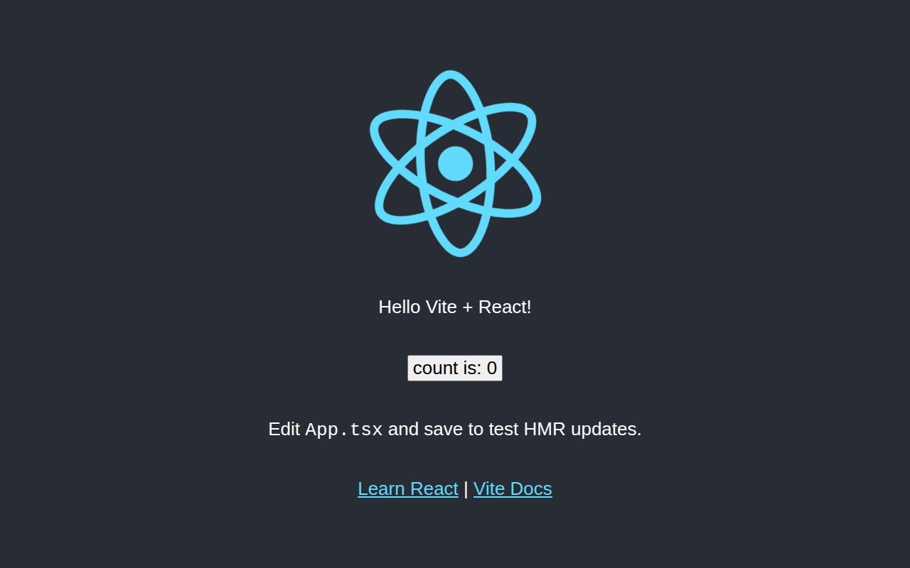

<p align="center">
  
</p>

<p align="center">
  <a href="https://xiaosang.cc/offer-calculator/">▶ 在线体验 Try Online</a>
  ·
  <a href="https://github.com/holynova/offer_calculator">GitHub 仓库</a>
</p>

> **当前状态：脚手架。** 本仓库的目标是做一个工作 Offer 并排比较工具（仓库描述："Compare and evaluate job offers side by side"），但目前代码仍是未改动的 Vite + React 模板——`App.tsx` 只有默认的 "Hello Vite + React!" 计数器，没有任何 Offer 比较功能。下面如实记录现有脚手架，比较功能待实现。

> **Current status: scaffold.** This repo aims to be a job-offer comparison tool ("Compare and evaluate job offers side by side"), but the code is still the unmodified Vite + React template — `App.tsx` only renders the default "Hello Vite + React!" counter, with no offer-comparison feature yet. This README documents the scaffold as it stands.

## 截图 / Screenshots

<p align="center">
  
</p>

## 现有什么 / What's Here

- Vite + React 18 + TypeScript 脚手架（`vite.config.ts` 默认配置，`@vitejs/plugin-react`）。
- 默认模板页面：React logo、计数器按钮、"Edit App.tsx and save to test HMR updates" 提示。
- HMR 热更新已就绪，改 `src/App.tsx` 保存即生效。

## 还没有 / Not Yet Implemented

- Offer 录入（薪资、奖金、期权、福利等字段）——无。
- 并排比较视图与总包换算——无。
- 数据存储（本地或远程）——无。
- 测试——无（`package.json` 无 test 脚本，仓库无测试文件）。

## 本地运行 / Run Locally

```bash
npm install
npm run dev      # Vite 开发服务器，HMR
npm run build    # tsc + vite build，产物输出至 dist/
npm run preview  # 本地预览生产构建
```

## 技术 / Tech

- React 18 + Vite 2 + TypeScript 4.6，唯一运行时依赖是 `react` 与 `react-dom`。
- 入口 `index.html` 标题仍是默认的 "Vite App"，实现功能时应一并改掉。

```
index.html              入口（标题仍为默认 Vite App）
vite.config.ts          Vite 默认配置 + React 插件
src/main.tsx            React 入口
src/App.tsx             默认模板页（计数器）
src/App.css             模板样式
src/index.css           全局样式
src/logo.svg            React logo
src/favicon.svg         图标
```

## English

**Offer Calculator** is intended to be a job-offer comparison tool ("Compare and evaluate job offers side by side"), but it is currently only a scaffold: the code is the unmodified Vite + React template, and `App.tsx` renders just the default "Hello Vite + React!" counter. No offer-comparison feature exists yet.

- **What's here**: a Vite + React 18 + TypeScript scaffold with HMR ready — edit `src/App.tsx` and it hot-reloads.
- **What's missing**: offer entry (salary, bonus, equity, benefits), side-by-side comparison views and total-compensation math, any data storage, and tests (no test script, no test files).
- **Run it**: `npm install && npm run dev`; build with `npm run build`; preview with `npm run preview`.
- **Tech**: React 18 + Vite 2 + TypeScript 4.6; the only runtime dependencies are `react` and `react-dom`. The `index.html` title is still the default "Vite App".

## 许可 / License

本仓库未附 LICENSE 文件，`package.json` 未声明 license。
